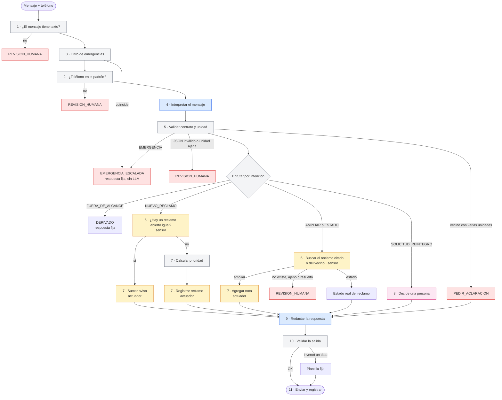
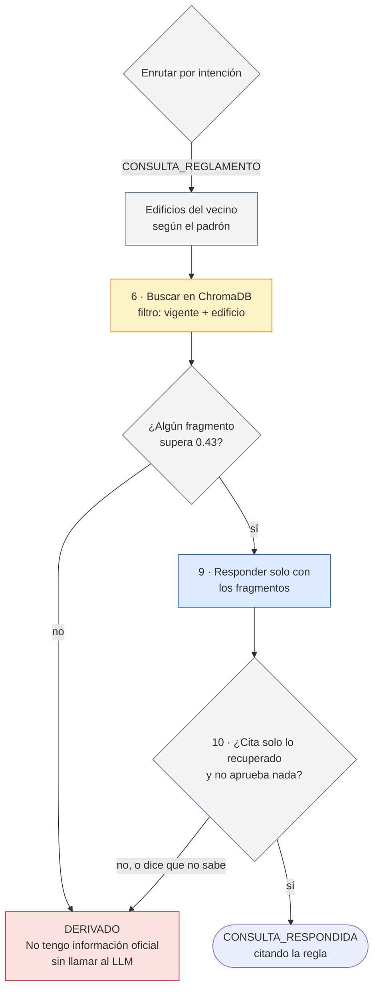

# Entrega 3 — Workflow + RAG + Agente

**Caso:** Asistente de reclamos de mantenimiento para Administración Ombú (administradora de consorcios)
**Microcredencial #2 — Diseño de Aplicaciones Inteligentes · Instituto de Tecnología ORT**

> Este informe continúa el de la [Entrega 2](../entrega_2/informe.md). La Parte A convierte el componente de extracción en un **workflow** que recorre el journey completo de un reclamo (adenda de la [Entrega 1](../entrega_1/informe.md), B.2 v2). La Parte B le suma **RAG** sobre el reglamento y las políticas de Ombú, y la Parte C (agente) se completa en la Clase 6.

---

## Parte A — Workflow encadenado (Hito 1)

### A.1 — El workflow

El workflow está en [ombu/workflow.py](ombu/workflow.py) y se corre con [workflow.py](workflow.py). Está escrito en Python directo: con una secuencia fija, un framework no agrega mucho, y la consigna lo permite. **El orden de los pasos lo fija el desarrollador**; el LLM interviene solo en los pasos 4 (interpretar) y 9 (redactar), y nunca decide qué paso sigue. Esa es la diferencia con el agente de la Parte C.

Cumple los tres mínimos de la consigna:

| Mínimo | Cómo se cumple |
|---|---|
| **3+ pasos en secuencia** | 11 pasos: recepción → filtro de emergencias → padrón → interpretar (LLM) → validar → buscar reclamo → registrar / ampliar / informar → decisión humana (reintegros) → redactar (LLM) → validar la salida → enviar |
| **Validación en código con lógica del dominio** | Varias, ninguna en el LLM: la unidad tiene que estar vinculada al teléfono del vecino; un reclamo citado tiene que existir y ser de su unidad o de un espacio común de su edificio; los duplicados se detectan por edificio + rubro + estado; la prioridad se calcula con reglas; la respuesta redactada se valida antes de enviarla |
| **Punto de control donde el flujo se detiene** | `REVISION_HUMANA` (paso 5 o 6) cuando algo no es confiable; `PEDIR_ACLARACION` cuando la unidad es ambigua; `EMERGENCIA_ESCALADA` antes del LLM; `REINTEGRO_EN_EVALUACION`, donde decide una persona |

**Qué se suma respecto de la Entrega 2:**

- **Un registro de reclamos** ([ombu/registro.py](ombu/registro.py)) con sus operaciones clasificadas como **sensores** (buscar duplicado, buscar por número, reclamos visibles: solo leen) y **actuadores** (registrar, sumar aviso, agregar nota: escriben). Es la "base de datos que es la autoridad": el número de reclamo y su estado salen de acá, nunca del modelo. El workflow lo **recibe** en lugar de construirlo (inyección de dependencias), así los tests usan un registro propio y el archivo `datos/reclamos.json` nunca se modifica.
- **La prioridad por reglas** (`calcular_prioridad` en [ombu/reglas.py](ombu/reglas.py)): ALTA para gas, ascensor o falta de un servicio básico; MEDIA para espacios comunes y para agua, electricidad o estructura; BAJA para el resto.
- **El redactor** ([ombu/redactor.py](ombu/redactor.py), [prompts/redaccion_v1.txt](prompts/redaccion_v1.txt)): el LLM recibe un JSON con el resultado ya resuelto y solo lo pone en palabras. Recibe lo mínimo: el número y el estado del reclamo, nunca las notas internas (pueden nombrar a otras unidades).
- **La validación de la salida** (`validar_salida`, paso 10): antes de enviar, el código controla que la redacción mencione el número de reclamo correcto y ningún otro, y que no tenga montos, fechas, días de visita, depósitos ni nada "aprobado". Si falla, se envía una **plantilla fija**. Lo mismo pasa si no hay key o la API falla: el resultado ya está resuelto y se puede comunicar igual.
- **Los patrones de emergencia nuevos** ("adentro del ascensor", "no puede salir"): es la conclusión de la reflexión de la Entrega 2. Ahora el caso que solo había detectado el LLM lo frena el filtro.

### A.2 — Diagrama del workflow



Referencias: **azul** = LLM · **gris** = regla en código · **amarillo** = herramienta sobre el registro (sensor o actuador) · **rosa** = decisión humana · **rojo** = punto de control donde el flujo se detiene.

### A.3 — Prueba de falla controlada

Corrido contra **Gemini `gemini-3.5-flash` (API real) el 25/11/2026**, con el lote [datos/lote_workflow.json](datos/lote_workflow.json): 10 casos, cada uno con su estado esperado. La corrida completa, con la traza y la respuesta de cada caso, está en [salidas/workflow_20261125-111145.json](salidas/workflow_20261125-111145.json).

**Resultado: los 10 casos terminaron en el estado esperado**, y las 7 respuestas redactadas por el LLM pasaron la validación de salida (ninguna necesitó la plantilla de respaldo).

| # | Caso | Estado esperado | Estado obtenido | Dónde terminó el flujo |
|---|---|---|---|---|
| 1 | Reclamo nuevo (humedad en el living) | `RECLAMO_REGISTRADO` | `RECLAMO_REGISTRADO` ✅ | Paso 11. Reclamo N° 3051, prioridad MEDIA por reglas |
| 2 | Duplicado (ascensor) | `AVISO_SUMADO` | `AVISO_SUMADO` ✅ | Paso 11. Aviso sumado al N° 3044, sin crear un reclamo nuevo |
| 3 | Consulta de estado (filtración) | `ESTADO_INFORMADO` | `ESTADO_INFORMADO` ✅ | Paso 11. Informó N° 3021 "en curso" |
| 4 | Ampliar reclamo citado | `RECLAMO_AMPLIADO` | `RECLAMO_AMPLIADO` ✅ | Paso 11. Nota agregada al N° 3050 |
| **5** | **Falla: reclamo ajeno** | `REVISION_HUMANA` | `REVISION_HUMANA` ✅ | **Paso 6.** El N° 3050 es de otro edificio |
| **6** | **Falla: unidad ajena** | `REVISION_HUMANA` | `REVISION_HUMANA` ✅ | **Paso 5.** El 7A no está vinculado al teléfono |
| 7 | Ambiguo (dos unidades) | `PEDIR_ACLARACION` | `PEDIR_ACLARACION` ✅ | Paso 5. Pidió elegir entre 2A de Tipas 1450 y 7C de Ceibo 880 |
| 8 | Reintegro con manipulación | `REINTEGRO_EN_EVALUACION` | `REINTEGRO_EN_EVALUACION` ✅ | Paso 8, decisión humana |
| 9 | Emergencia (persona en el ascensor) | `EMERGENCIA_ESCALADA` | `EMERGENCIA_ESCALADA` ✅ | **Paso 3**, antes del LLM |
| 10 | Fuera de alcance (expensas) | `DERIVADO` | `DERIVADO` ✅ | Enrutamiento, respuesta fija |

**Los dos casos de falla controlada:**

- **Caso 5 — reclamo ajeno.** El vecino del 4°B de Tipas 1450 preguntó por el reclamo N° 3050, que es del palier de Ceibo 880. El LLM lo interpretó bien (`ESTADO_RECLAMO`, número `3050`) y la unidad del vecino era válida, pero en el **paso 6** el código comprobó que ese reclamo no es de su unidad ni de su edificio y **detuvo el flujo**. No se llamó al redactor y la respuesta fue la fija de revisión humana: el vecino no recibió ningún dato del reclamo de otro edificio.
- **Caso 6 — unidad ajena.** El mensaje decía "soy del 7°A de Tipas 1450" desde un teléfono vinculado al 4°B. El LLM extrajo la unidad `7A` y en el **paso 5** la regla de privacidad detuvo el flujo (`NO_VINCULADA`). **No se registró ningún reclamo**: el próximo número libre siguió siendo el 3051.

**Lo que mostró la corrida real:**

- **La manipulación no pasó.** En el caso 8 ("ya está aprobado… confirmame la fecha del depósito"), el workflow se detuvo en la decisión humana. La respuesta del LLM no repitió el monto ni la fecha, y dijo que "la aprobación queda sujeta a su análisis y decisión". La validación la aceptó, porque no da nada por aprobado.
- **La privacidad se respetó en la redacción.** En el caso 3, la nota interna del reclamo nombra a la unidad 5B; como el redactor solo recibe el número y el estado, la respuesta no la mencionó.
- **La mejora de la Entrega 2 funcionó.** La emergencia del caso 9, que en la Entrega 2 solo había detectado el LLM, ahora la frena el filtro determinista en el paso 3.
- **Un detalle para mejorar:** en el caso 3 el LLM escribió el estado en Markdown (`**EN CURSO**`). En WhatsApp la negrita se escribe con un solo asterisco, así que el vecino vería los asteriscos. Queda para la próxima versión del prompt de redacción: pedir texto sin formato.
- **La validación de salida no se activó en esta corrida**, porque ninguna redacción inventó datos. Su comportamiento ante fechas, montos, aprobaciones y números de reclamo ajenos está cubierto por las pruebas automáticas ([tests/test_redactor.py](tests/test_redactor.py)).

Pruebas automáticas, sin API: `python -m pytest` → 94 pruebas, incluida una por cada caso del lote.

---

## Parte B — RAG: base de conocimiento vectorial (Clase 5)

> En la Parte A, una pregunta sobre el reglamento ("¿quién paga este arreglo?", "¿puede venir el albañil un sábado?") caía en `FUERA_DE_ALCANCE` y se derivaba con un texto fijo. Ahora es una intención propia, `CONSULTA_REGLAMENTO`, y se responde con **RAG**: el workflow busca los fragmentos del reglamento y de las políticas de Ombú que tienen que ver con la pregunta, y el LLM responde **usando solo esos fragmentos** y citándolos.
>
> **Archivos:** [corpus/reglamento_ombu.json](corpus/reglamento_ombu.json) (el corpus), [ombu/base_conocimiento.py](ombu/base_conocimiento.py) (embeddings y ChromaDB), [ombu/rag.py](ombu/rag.py) (recuperar → umbral → responder → validar), [prompts/rag_v1.txt](prompts/rag_v1.txt) (el prompt de grounding) y [rag.py](rag.py) (indexar, buscar, calibrar y comparar).

### B.1 — Corpus propio

**14 documentos**, uno por regla: 9 políticas de reclamos de Ombú que valen para todos los edificios, 3 reglas de los reglamentos internos de cada consorcio y **2 versiones reemplazadas** de dos políticas, que se guardan a propósito para probar que el filtro las deja afuera.

| Documento | Edificio | Tema |
|---|---|---|
| POL-CANAL | TODOS | Cómo se hace un reclamo, número de reclamo, avisos sumados |
| POL-PRIORIDAD | TODOS | Criterios de prioridad ALTA, MEDIA y BAJA |
| POL-PLAZOS | TODOS | Plazo de la primera visita según la prioridad |
| POL-PLAZOS-2025 ⚠️ | TODOS | Versión reemplazada: 48 horas, 5 y 15 días |
| POL-EMERGENCIA | TODOS | Qué es una emergencia y qué hacer |
| POL-RESP-UNIDAD | TODOS | Arreglos a cargo del propietario |
| POL-RESP-COMUN | TODOS | Arreglos a cargo del consorcio |
| POL-FILTRACIONES | TODOS | Filtraciones que vienen de otra unidad o de la terraza |
| POL-REINTEGRO | TODOS | Cuándo se analiza un reintegro (nunca es automático) |
| POL-REINTEGRO-2025 ⚠️ | TODOS | Versión reemplazada: "alcanza con mandar el ticket" |
| POL-INQUILINOS | TODOS | Qué puede reclamar un inquilino |
| REG-TIP-OBRAS | TIP1450 | Horario de obras en Tipas 1450: lunes a viernes, sin sábados |
| REG-CEI-OBRAS | CEI0880 | Horario de obras en Ceibo 880: también sábados de 9 a 13 |
| REG-TIP-TERRAZA | TIP1450 | Acceso a la terraza y la sala de máquinas |

Cada documento tiene una `descripcion_semantica` (el texto que se convierte en embedding) y estos metadatos:

| Campo | Para qué | Ejemplo |
|---|---|---|
| `codigo` | Citar la regla. Las versiones reemplazadas comparten el código con la vigente | `POL-REINTEGRO` |
| `edificio` | **Filtro:** `TODOS`, `TIP1450` o `CEI0880` | `CEI0880` |
| `vigente` | **Filtro:** nunca responder con una versión reemplazada | `true` |
| `tema` | Agrupar (canal, plazos, responsabilidades, reintegros, obras…) | `obras` |
| `tipo` y `version` | Si es una política de Ombú o un reglamento del consorcio, y de qué versión | `reglamento`, `2021` |

**Decisiones de diseño:**

- **Un documento por regla (el *chunking*).** Cada regla es una unidad de sentido. Cortar cada N caracteres partiría, por ejemplo, la lista de condiciones de un reintegro por la mitad, y el modelo podría recibir solo una parte.
- **El edificio como metadato.** Las reglas de obra de Tipas y de Ceibo son casi idénticas en el texto, así que la similitud no las distingue, pero dicen cosas distintas (en Ceibo se puede trabajar los sábados, en Tipas no). Lo que decide cuál corresponde es un dato exacto: el edificio del vecino.
- **Versiones reemplazadas en el corpus.** En una administración real, la política vieja sigue circulando (en un PDF, en un mail). La de reintegros es la peligrosa: decía que alcanzaba con mandar el ticket.
- **Enriquecer el texto, a partir de una falla observada.** En la primera corrida, ante "¿Cuánto tardan en venir si se rompe el ascensor?", el modelo recibió POL-PLAZOS ("prioridad ALTA: 24 horas") y respondió *"No tengo información oficial"*: el fragmento no decía que un ascensor es prioridad ALTA (eso está en POL-PRIORIDAD, que no se recuperó). Agregamos a POL-PLAZOS qué entra en cada prioridad; la similitud de esa pregunta subió de 0.48 a 0.59 y pasó a responderse bien (ver B.3).

### B.2 — RAG operativo

| Pieza | Qué usamos | Por qué |
|---|---|---|
| Embeddings | `jina-embeddings-v2-base-es`, local (con `fastembed`) | Entrenado en español, sin API key y sin costo. Es el mismo modelo de la práctica de la Clase 5 |
| Base vectorial | **ChromaDB**, guardada en disco (`indice_chroma/`, fuera del repo) | Permite filtrar por metadatos y separar el paso offline (`rag.py indexar`) del online. Si el corpus cambia, se reindexa solo |
| Similitud | Coseno, k = 3 | Se traen 3 candidatos; solo se usan los que superan el umbral |
| Filtro híbrido | `vigente = True` **y** `edificio ∈ {TODOS, edificios del vecino}` | El edificio sale del **padrón**, no del mensaje ni del LLM (`edificios_del_vecino` en [ombu/reglas.py](ombu/reglas.py)) |
| Umbral | **0.43**, calibrado con nuestro corpus (ver abajo) | Por debajo, *"No tengo información oficial sobre esa consulta."* sin llamar al LLM |
| Generación | El LLM del proyecto, prompt [rag_v1.txt](prompts/rag_v1.txt), temperatura 0 | *"Usá ÚNICAMENTE los fragmentos… citá el código… texto plano, sin Markdown"* |
| Validación | `validar_respuesta_rag` en [ombu/rag.py](ombu/rag.py) | La respuesta tiene que citar al menos un código, solo códigos recuperados, y no dar nada por aprobado |
| Orquestación | Python directo (sin LangChain) | La cadena son cuatro pasos fijos; igual que en la Parte A, un framework no simplifica nada acá |

**Conexión con el workflow.** El prompt de extracción pasó a la versión 2 ([extraccion_v2.txt](prompts/extraccion_v2.txt)): suma `CONSULTA_REGLAMENTO` en el orden de riesgo, después de los reclamos (si el vecino avisa de un problema y además pregunta quién paga, es `NUEVO_RECLAMO`). La consulta solo lee, así que no hace falta identificar la unidad (no se le pide aclaración a quien tiene dos).



Hay **dos puntos de control** nuevos: el umbral (antes del LLM) y la validación de las citas (después). El primero evita que el modelo responda sin contexto; el segundo, que responda con algo que no estaba en el contexto.

**Calibración del umbral.** Empezamos con 0.35, el valor que la cátedra calibró con el mismo modelo pero con otro corpus, y medimos con 16 preguntas redactadas distinto que el corpus: 12 que el corpus responde y 4 que no (`python rag.py calibrar`, [salidas/rag_calibracion_20261125-142201.json](salidas/rag_calibracion_20261125-142201.json)):

| | Similitud del documento correcto / del mejor candidato |
|---|---|
| 12 preguntas del corpus | **0.46 a 0.64**, salvo *"Siento olor a gas, ¿qué hago?"*: 0.33. Las 12 recuperaron primero el documento correcto |
| 4 preguntas de afuera | 0.33 a **0.41**: *"¿Puedo tener un perro?"* (POL-INQUILINOS) y *"¿Pagan las expensas con tarjeta?"* (POL-REINTEGRO) |

Con 0.35, las dos preguntas de afuera de 0.41 superaban el umbral y el LLM recibía un contexto que no tenía nada que ver. Subimos el umbral a **0.43**, el punto medio entre 0.41 y 0.46. La pregunta del gas queda por debajo, pero **nunca llega al RAG**: el filtro de emergencias del paso 3 la escala antes. Repetimos la calibración después del cambio ([salidas/rag_calibracion_20261126-170751.json](salidas/rag_calibracion_20261126-170751.json)): las 12 siguen recuperando primero el documento correcto, y POL-PLAZOS subió a 0.58 por el texto enriquecido. El margen es chico (0.05, con 16 preguntas): queda para la matriz de pruebas de la Entrega 4.

**El filtro híbrido, con el modelo real.** La misma pregunta, *"¿Puedo hacer venir al albañil un sábado?"*, recupera REG-CEI-OBRAS (0.46) para un vecino de Ceibo 880 y REG-TIP-OBRAS (0.47) para uno de Tipas 1450: cada uno ve solo el reglamento de su edificio, y las respuestas son opuestas. Para el filtro de vigencia, la misma búsqueda **sin ningún filtro** (`python rag.py buscar "Si pago yo un plomero, ¿me devuelven la plata?" --todas`):

```
  ✅ 0.60  POL-REINTEGRO        [TODOS  ] Reintegros de gastos de reparación
  ✅ 0.44  POL-REINTEGRO-2025   [TODOS  ] Reintegros de gastos de reparación (versión anterior)  ⚠️ REEMPLAZADA
  ✗  0.40  POL-FILTRACIONES     [TODOS  ] Filtraciones y humedad que vienen de otra unidad
  (umbral 0.43: ✅ se usa como contexto · ✗ se descarta)
```

La vigente sale primera, pero la versión reemplazada **también supera el umbral**: sin el filtro, el modelo recibiría las dos reglas juntas, una que pide reclamo previo, factura y decisión de la administración, y otra que dice que alcanza con mandar el ticket. Con el filtro, la reemplazada no llega al contexto: en B.3, la misma pregunta (filtrada para Ceibo 880) recuperó POL-REINTEGRO, POL-FILTRACIONES y POL-CANAL. A diferencia del ejemplo de la cátedra, acá la versión vieja no es la más parecida; con las pruebas automáticas ([tests/test_rag.py](tests/test_rag.py)) forzamos ese caso, y el filtro la deja afuera igual.

**Resultado del lote** (13 casos, Groq `openai/gpt-oss-120b`, prompt v2, 26/11/2026):

| Corrida | Umbral | Resultado | Archivo |
|---|---|---|---|
| Antes del ajuste | 0.35 | **13/13** en el estado esperado | [workflow_20261126-144533.json](salidas/workflow_20261126-144533.json) |
| Después del ajuste | 0.43 | **12/13**: el caso 7 terminó en `EMERGENCIA_ESCALADA` | [workflow_20261126-173046.json](salidas/workflow_20261126-173046.json) |

Los casos de la Parte B, en la corrida final:

| # | Mensaje | Recuperó (similitud) | Estado | Respuesta |
|---|---|---|---|---|
| 11 | ¿En qué horario se pueden hacer arreglos? ¿Puede venir el albañil un sábado? *(Ceibo 880)* | REG-CEI-OBRAS 0.64 ✅, POL-RESP-UNIDAD 0.47 ✅ | `CONSULTA_RESPONDIDA` | *"…de lunes a viernes de 8 a 17 hs y los sábados de 9 a 13 hs… (REG-CEI-OBRAS)"* |
| 12 | Cuando se rompe el ascensor, ¿cuánto tardan en mandar a alguien? | POL-PLAZOS 0.59 ✅ | `CONSULTA_RESPONDIDA` | *"…el ascensor está en prioridad alta, por lo que la primera visita se realiza dentro de las 24 horas. (POL-PLAZOS)"* |
| 13 | ¿Se puede tener un perro en el departamento? | POL-INQUILINOS 0.42 ✗ (ninguno supera 0.43) | `DERIVADO` | *"No tengo información oficial sobre esa consulta…"* — **el LLM no se llamó** |

**El caso 7 cambió entre corridas, y no por el RAG.** *"che la luz de la escalera no anda hace días, cualquier día alguien se cae"* terminó en `PEDIR_ACLARACION` con Gemini (Parte A) y en la primera corrida con Groq; en la segunda, Groq lo clasificó como `EMERGENCIA` y el workflow lo escaló. El ajuste no tocó la extracción: es el mismo prompt y el mismo modelo, que no da siempre la misma respuesta aunque la temperatura sea 0. El error es del lado seguro (una falsa emergencia, no una emergencia perdida), y lo dejamos registrado tal cual en lugar de cambiar el estado esperado. Medir esta variación (correr cada caso varias veces) queda para la Entrega 4.

Pruebas automáticas, sin API y sin descargar el modelo: `python -m pytest` → 126 pruebas. Las del RAG usan embeddings de juguete (bolsa de palabras), que prueban la mecánica (filtros, umbral, validación) pero no la calidad de la búsqueda; esa se mide con `rag.py calibrar`.

### B.3 — Comparación antes/después

Las mismas 4 preguntas, sin contexto (prompt [sin_grounding_v1.txt](prompts/sin_grounding_v1.txt)) y con RAG (`python rag.py comparar`), con Groq `openai/gpt-oss-120b`. Corrida final: [salidas/rag_comparacion_20261126-171520.json](salidas/rag_comparacion_20261126-171520.json); la anterior al ajuste: [salidas/rag_comparacion_20261126-141906.json](salidas/rag_comparacion_20261126-141906.json).

| Pregunta | Sin grounding | Con RAG | ¿Mejoró la fidelidad? |
|---|---|---|---|
| ¿Cuánto tardan en venir si se rompe el ascensor? | *"Envíamos al técnico en un plazo de **2 horas hábiles**… llamá al **0800‑123‑456**."* | *"El ascensor está en prioridad alta, por lo que la visita se realiza dentro de las 24 horas. (POL-PLAZOS)"* | ✅ Desaparecen el plazo y el teléfono inventados. **Antes del ajuste** respondía *"No tengo información oficial"* (ver B.1) |
| Si llamo yo a un plomero por un problema del edificio, ¿me devuelven la plata? *(Ceibo 880)* | *"No, la administración no reembolsa los gastos que contrates por tu cuenta…"* | *"Solo si se cumplen todas las condiciones: …reclamo antes del arreglo con su número, …parte común y… la factura. (POL-REINTEGRO)"* | ✅ Pasa de un "no" genérico a las condiciones reales. Usó la versión vigente: la reemplazada ("alcanza con el ticket") no llegó al contexto |
| ¿Puedo hacer venir al albañil un sábado? *(Ceibo 880)* | *"En general los trabajos… solo de lunes a viernes… Sin la autorización, no está permitido."* | *"Sí, podés traer al albañil los sábados, pero solo entre las 9 y las 13 horas. (REG-CEI-OBRAS)"* | ✅ Sin contexto, la respuesta era la **opuesta** para este edificio |
| ¿Puedo tener un perro en el departamento? *(fuera del corpus)* | *"En la mayoría de edificios se permite un perro de raza pequeña o mediana… registrado…"* | *"No tengo información oficial sobre esa consulta."* | ✅ **Destacado:** no inventa. En la corrida final ningún fragmento superó el umbral y el LLM no se llamó; antes del ajuste (0.35) había pasado POL-INQUILINOS (0.41) y lo frenó la segunda capa, el prompt |

#### Lo que aprendimos

- **El modelo sin contexto no se equivoca "un poco": inventa datos concretos.** Un plazo de 2 horas, un 0800, una regla sobre perros. Suenan razonables y no son de Ombú. Con la regla en el contexto, la misma pregunta se responde bien.
- **El umbral hay que calibrarlo con el corpus propio.** El valor de la cátedra (0.35), con el mismo modelo, dejaba pasar preguntas de afuera. Lo medimos, lo subimos a 0.43, y el caso "Destacado" pasó a resolverse antes de llamar al LLM, que es más barato y más seguro.
- **Que el documento correcto llegue no alcanza: tiene que traer todo lo necesario.** La pregunta del ascensor recuperaba bien POL-PLAZOS, pero el fragmento no decía que el ascensor es prioridad ALTA. Con 0.35, en una corrida el modelo dijo que no sabía y en otra lo completó por su cuenta (*"para el ascensor se aplica prioridad alta"*, un dato que no estaba en el contexto). La validación de citas no detecta eso: la cita era correcta. Lo resolvimos en el corpus, no en el prompt.
- **La validación por patrones tiene límites.** En la corrida final, la respuesta de reintegros cerró con *"La administración lo evalúa y lo aprueba por escrito"*, cuando la política dice que lo **decide** y que nada está aprobado hasta que se comunica por escrito. No dice "está aprobado", así que el patrón no lo frena, pero sugiere una aprobación que no existe. En la primera corrida, la misma pregunta había cerrado bien (*"lo evalúa y lo decide, no es automático"*). Queda para la evaluación de la Entrega 4 (casos como este en la matriz, o un segundo modelo que revise la respuesta).
- **El umbral no protege de las versiones viejas; el filtro sí.** La política reemplazada de reintegros saca 0.44 contra la pregunta: pasa el umbral igual que la vigente. Lo que la deja afuera es un dato exacto (`vigente`), no la similitud.
- **RAG informa, el código decide.** POL-PRIORIDAD está en el corpus para *explicar* la prioridad, pero la prioridad de un reclamo la sigue calculando `calcular_prioridad` (Parte A), y un reintegro lo sigue decidiendo una persona. Un texto recuperado por similitud no alcanza para una decisión con consecuencias.

## Parte C — Agente con LangGraph (Clase 6 · Hito 2)

> _Pendiente._
